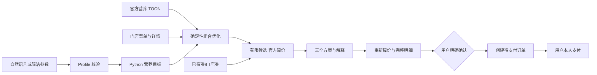

<div align="center">

# 💪 麦麦肌肉大王 · McMuscle AI

### Fuel Your Gains. Save Your Wallet.

**增肌不乱吃，减脂不挨饿，蛋白质和钱包我都要。**

[English](README_EN.md) · [安装](docs/INSTALL.md) · [真实只读演示](docs/LIVE_DEMO.md) · [MOCK 演示](examples/MOCK_DEMO.md) · [验证记录](docs/VALIDATION.md)


</div>

**告诉 AI 你的健身目标、预算和偏好，让 Python 计算，让麦当劳官方 MCP 验证价格。**

面向希望比较麦当劳餐品营养与花费的健康成人。它是一个可安装的 AI Skill，包含真正运行的 Python 营养引擎、确定性组合搜索、实时菜单适配与订单确认逻辑，不需要网站或服务器。

> 独立开发的第三方开源作品，不代表麦当劳官方立场。一般性饮食辅助，非医疗诊断或治疗工具。真实订单只在用户明确确认后创建；付款由用户本人完成。

## 看一个真实结果

2026-10-09，北京时间16:14前后，对上海人民广场公开示例门店进行只读验证。输入为**虚构测试画像**：75kg、增肌、预算40元、本餐规划650 kcal；不是作者个人信息。

|目标|餐品|热量|蛋白质|官方应付|
|---|---|---:|---:|---:|
|蛋白质大王|双层吉士汉堡 + 薄皮焦香V翅|621 kcal|44 g|¥39.00|
|省钱肌肉王|双层吉士汉堡 + 薄皮焦香V翅|621 kcal|44 g|¥39.00|
|热量控制王|双层吉士汉堡 + 盒装纯牛奶 + 圆筒冰淇淋|651 kcal|36 g|¥38.50|

这是**限定候选中的比较**：15个核对详情的单品、最多3份、6次官方算价；不同目标允许得到同一组合。没有假定优惠券叠加，没有创建订单。价格与供应会变化，详见 [完整运行结果](docs/LIVE_DEMO.md)。

## 你可以这样说

> 使用麦麦肌肉大王，我75kg，增肌，午餐预算40元，喜欢牛肉，不喜欢鱼，帮我搭配。

> 使用 $mcmuscle，给我比较一顿减脂餐。体重65kg，预算35元；先用 MOCK DEMO 看效果。

> I am 75kg, trying to gain muscle, with a 40 yuan budget. Compare protein and price.

不想填完整身体信息也可以，只给目标、体重、预算和偏好。缺少身高、年龄、公式适用性别或全天活动水平时，系统不会声称算出了 TDEE。存在过敏但缺少可靠过敏原资料时，会拒绝推荐相关未知餐品。

## 三种方案，计算过程可解释

- **Protein Max / 蛋白质大王**：先满足硬约束，再优先蛋白质。
- **Best Protein Value / 省钱肌肉王**：综合每克蛋白质成本、目标缺口、热量偏差和偏好；减脂时加大热量偏差权重。
- **Calorie Smart / 热量控制王**：优先匹配本餐热量，同时考虑蛋白质、脂肪与碳水。未设置热量目标时明确提示无法评估减脂匹配。

预算、过敏、必须排除项、明确的营养上限是硬约束。偏好用于评分与平分选择。搜索默认至多4份，每项有数量上限，并设置80,000节点上限；提前截断时不声称全局最优。即使本地枚举完成，也仅能证明该限定空间内的比较，不能证明所有门店、券和套餐的全局最优。

## 工作流



## 安装与配置

macOS + Python 3.11+：从 GitHub **Code → Download ZIP** 下载并解压，双击 `Install.command`。如果系统阻止打开，请右键选择“打开”。在 Codex 中打开该项目文件夹。

随后双击 `Setup Token.command`，把在 [官方 MCP 平台](https://open.mcd.cn/mcp) 刚生成的新 Token 填入本机隐藏输入框。旧 Token 如曾泄漏，先在官方控制台撤销。**不要把 Token 发到聊天或写入代码。**

Token 存到 macOS 钥匙串，由客户端和 Python 程序按需读取。其他系统的凭证配置和客户端适配见 [完整安装指南](docs/INSTALL.md)。

开发者可执行：

```bash
python3 scripts/install.py
.venv/bin/mcmuscle demo
.venv/bin/mcmuscle probe
```

项目级 Skill 位于 `.agents/skills/mcmuscle/SKILL.md`。安装完整仓库，单独拷贝 SKILL.md 不够。若未发现更新，重新打开项目或重启客户端。

## 营养方法与指标

完整参数的健康成人使用常用简化 Mifflin–St Jeor 公式（静息能量估算，界面标作 BMR），再乘用户选择的全天活动系数。每周训练次数不自动代替活动水平。默认增肌+10%、减脂−15%，可配置但拒绝极端缺口；这属于产品规划参数，不是临床处方。

运动人群每日蛋白质使用1.4–2.0 g/kg范围，默认一餐分配每日目标的1/3。脂肪规划为能量的30%，碳水为剩余能量；参数不完整时只提供能计算的范围。特殊人群、低体重减脂等不套用普通公式。依据及局限详见 [算法说明](docs/ALGORITHMS.md)。

指标包括 `应付元 / 蛋白质克数`、每100 kcal蛋白质、每100元蛋白质、热量偏差和蛋白目标完成比例。分母为0时标记不可计算。外送计入已确认配送费；费用字段无法确认就停止价格推荐。

## 官方数据、优惠券和订单

- 营养由 `list-nutrition-foods` 提供，支持官方 JSON 包装的 TOON 数据。校验单位、必需营养值、重复项、别名及来源时间；不编造未知餐品营养。
- 在售菜单由 `query-meals` 获取，与营养数据库精确匹配，再查 `query-meal-detail`。自动流程先支持标准单品；复杂套餐通过完整组件选择与 `bundle()` 聚合，未知组件/特制营养排除。
- 查询可领取、已持有、门店适用券；领券需另外明确授权。官方 `calculate-price` 是价格依据，不能从券名推算。原价超预算组合可先保留，算价后仍超预算则剔除。会员随单购不自动购买。
- `prepare` 重新报价、核对餐品和取餐方式；`OrderService` 要求与该计划绑定的明确确认。报价有效期120秒，参数变化重新确认，持久化摘要防重复提交。创建订单不自动重试、不自动支付。

**验证范围**：营养、附近门店、实时菜单、详情、三类券查询和无券算价已真实只读验证。当前测试账号没有已持有/门店适用券，折扣与异常分支用 Mock 验证。订单创建仅 Mock 测试；外送地址/门店/含配送及打包费算价也已只读验证；实际订单、领券、支付均未执行。完整工具列表和状态见 [MCP_INTEGRATION.md](MCP_INTEGRATION.md)。

## 测试与工程质量

```bash
.venv/bin/python -m pip install -e '.[live,dev]'
.venv/bin/pytest
.venv/bin/ruff check .
.venv/bin/mypy src
.venv/bin/pip-audit
```

自动测试阻断网络并清除 Token 环境变量；CI 不配置私人凭证、不创建订单。覆盖营养计算、独立暴力枚举对照、预算/过敏/排除、TOON、算价、401/429/网络失败、确认绑定与跨进程重放保护等。GitHub Actions 检查 Python 3.11/3.12/3.13。

## 隐私与安全

原始身体参数、账号券、配送地址和订单明细只保留在本地私密工作区，默认不持久化到公开文件。项目包含忽略规则和源码/历史凭证扫描脚本。钥匙串读取器仅供 MCP 使用，不要手动运行 `headers` 子命令并复制其输出。导出演示时使用合成画像，清理账户标识。

官方数据可能变化或缺失；TOON解析器支持当前已验证的嵌套对象和标量表格子集，未知语法会明确失败。不能保证过敏安全的未知食品不进入推荐。营养估算不能替代专业医疗意见。

## 项目结构

```text
.agents/skills/mcmuscle/  Skill入口、客户端元数据和实时工作流参考
src/mcmuscle/            输入、营养、组合优化、MCP、算价、订单与CLI
scripts/                安装与发布前扫描
tests/                  无Token自动测试
examples/               合成输入和可复现演示
docs/                   安装、算法、真实验证与进度
```

## 开源与参赛

**报名 Issue 已提交，等待官方审核：[官方比赛 #39](https://github.com/M-China/mcd-developer-innovation-challenge/issues/39)。**

本项目的原创代码采用 [MIT License](LICENSE)。[官方参赛声明](CONTEST_DECLARATION.md) 为官方文件原样复制，其内容和麦当劳数据/商标不受本项目 MIT 授权扩张。

参加 [麦当劳程序员创意开发大赛](https://github.com/M-China/mcd-developer-innovation-challenge)。正式截止北京时间2026-10-25 23:59，报名以官方 Issue 回复为准；仓库发布不等于报名成功。参赛与阶段状态见 [PROGRESS.md](docs/PROGRESS.md)。不购买或操纵 Star。
